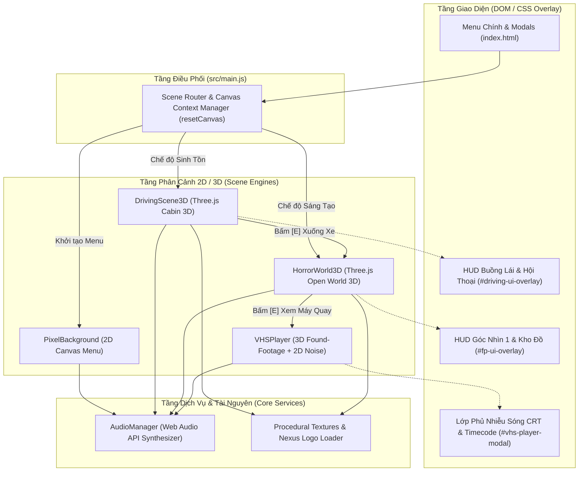
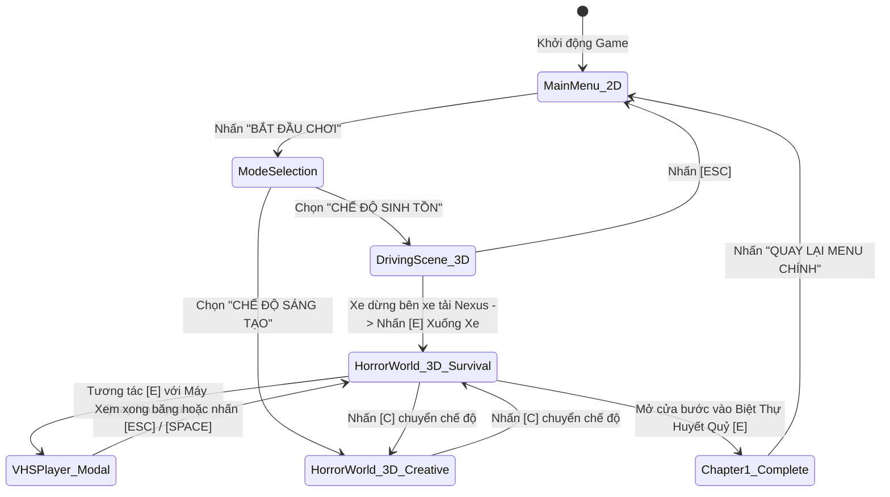

# 🏗️ Mô Hình Kiến Trúc Hệ Thống (Architecture Model)
**Dự án:** Bloodfiend – Huyết Quỷ (`isj-demo-horror-game-bloodfiend`)  
**Đơn vị phát triển:** Icey Studio (Founder chính: `MinhPhuc00Ne` / `Jos`) & Bloodfiend Development Team (`MinhPhuc00Ne / Jos`, `LynnieSepearl`, `Zanny2006`, `QuytFen`)

---

## 1. Tổng Quan Kiến Trúc
**Bloodfiend – Huyết Quỷ** sử dụng **Kiến Trúc Điều Phối Phân Cảnh Kết Hợp 2D/3D (Hybrid 2D/3D Scene-Driven Architecture)** chạy trực tiếp trên trình duyệt thông qua **Vite**, **Three.js (WebGL)**, **HTML5 Canvas 2D** và **Web Audio API**.

Hệ thống được chia thành 4 tầng kiến trúc rõ rệt:
1. **Tầng Điều Phối Trung Tâm (Application & Scene Router Layer)**: Quản lý vòng đời ứng dụng, chuyển đổi ngữ cảnh `<canvas>` giữa 2D và 3D.
2. **Tầng Phân Cảnh Thực Thi (Scene Execution Layer)**: Chứa các phân cảnh độc lập (`PixelBackground`, `DrivingScene3D`, `HorrorWorld3D`, `VHSPlayer`).
3. **Tầng Giao Diện & Lớp Phủ (UI / HUD Overlay Layer)**: Hệ thống DOM/CSS phản hồi nhanh, hiển thị hội thoại, tâm ngắm, kho đồ và hiệu ứng màn hình CRT.
4. **Tầng Dịch Vụ Lõi & Tài Nguyên Thủ Tục (Core Services & Procedural Assets Layer)**: Bộ tổng hợp âm thanh `AudioManager` và trình tự sinh họa tiết 2D/3D `Procedural Texture Generator`.

---

## 2. Sơ Đồ Kiến Trúc Tổng Thể (System Architecture Diagram)



---

## 3. Luồng Chuyển Đổi Trạng Thái Trò Chơi (Game State Machine)



---

## 4. Chi Tiết Các Phân Hệ Kỹ Thuật

### 4.1. Cơ Chế Chuyển Đổi Linh Hoạt 2D <-> 3D (`resetCanvas`)
Do đặc thù của chuẩn HTML5 `<canvas>`, một phần tử Canvas sau khi đã gọi `getContext('2d')` (dùng cho `PixelBackground`) sẽ không thể gọi `getContext('webgl2')` (dùng cho `THREE.WebGLRenderer`) và ngược lại.  
Để giải quyết triệt để:
- Mỗi khi chuyển cảnh trong [`src/main.js`](../src/main.js), hàm `resetCanvas()` sẽ hủy nút DOM `<canvas id="pixel-canvas">` cũ và thay thế bằng một phần tử `<canvas>` hoàn toàn mới.
- Nhờ đó, bộ nhớ GPU của ngữ cảnh cũ được thu hồi sạch sẽ và ngữ cảnh 3D/2D mới khởi chạy tức thì.

### 4.2. Phân Hệ Thế Giới Kinh Dị 3D (`HorrorWorld3D`)
Phân hệ lớn nhất của dự án ([`src/horrorWorld3D.js`](../src/horrorWorld3D.js)) bao gồm:
- **Hệ thống Địa hình & Kiến trúc**:
  - Quốc lộ nhựa dài hơn 160m có vạch kẻ đường, đinh phản quang, hộ lan kim loại và cột điện.
  - Hiện trường xe tải giao hàng **Nexus Logistics** gặp nạn với thùng hàng rỗng mở toang hai cánh, nhìn rõ kệ thuốc sinh học và thùng bảo ôn bị đổ bên trong.
  - Cây đại thụ nơi thi thể tài xế Phúc nằm gục cùng chiếc máy quay Handycam Hi8 có màn hình LCD lật mở và con dao găm sinh tồn cắm trên thân cây.
  - Đại Biệt Thự Huyết Quỷ phong cách Gothic 3 khối nhà (Tòa Trung Tâm, Cánh Tây Nghĩa Địa, Cánh Đông Nhà Kính), tháp chuông cao 35m, thềm hiên đá tam cấp, cổng vòm đá nhiều tầng và cửa đôi gỗ lim mở hé nhìn xuyên vào sảnh thảm đỏ bên trong.
- **Hệ thống Vật lý & Độ cao Mặt sàn (`getGroundElevation`)**:
  - Tự động nội suy độ cao mặt đứng khi người chơi bước lên 6 bậc thang đá tam cấp (`y = 0.0m -> 1.4m`), đảm bảo tầm mắt người chơi (`naturalEyeY = groundY + 1.65m`) luôn chuẩn xác trên thềm hiên biệt thự.
  - Hỗ trợ nhảy trọng lực (`Space`) và chế độ bay lượn tự do kiểu Minecraft (`Double-tap Space` ở chế độ Sáng Tạo).
- **Hệ thống Vũ khí Góc nhìn thứ nhất (FPS Viewmodel)**:
  - Mô hình con dao găm 3D (`this.fpsKnife`) được gắn trực tiếp vào đối tượng `this.camera`, tạo chuyển động lắc lư theo nhịp bước chân và hoạt ảnh vung chém chéo khi click chuột trái.

### 4.3. Phân Hệ Trình Phát Băng VHS 3D (`VHSPlayer`)
Kết hợp đồng thời **2 lớp Canvas chồng lên nhau**:
1. **Lớp dưới (`WebGLRenderer 3D`)**: Dựng cảnh rừng đêm 3D góc nhìn thứ nhất của nạn nhân đang chạy trốn, quay đầu nhìn lại phía sau và bị thực thể bóng đen mắt đỏ lao vồ với tốc độ siêu thanh (chỉ 0.38 giây), sau đó máy quay rơi xuống bùn.
2. **Lớp trên (`Canvas 2D Overlay`)**: Vẽ hiệu ứng sọc nhiễu từ tính VHS, vết máu bắn lên ống kính và nhiễu trắng cắt đứt tín hiệu ở cuối băng.

### 4.4. Phân Hệ Âm Thanh Thủ Tục (`AudioManager`)
Không phụ thuộc vào các file `.mp3` hay `.wav` bên ngoài, [`src/audio.js`](../src/audio.js) sử dụng trực tiếp các bộ dao động sóng âm (`OscillatorNode`), bộ lọc tần số (`BiquadFilterNode`) và bộ đệm nhiễu trắng (`AudioBuffer`) của **Web Audio API** để tổng hợp:
- Tiếng mưa rơi rả rích và tiếng gió rít u ám nền.
- Tiếng bước chân lội bùn, tiếng bước chân trên đá, tiếng bật/tắt đèn pin, tiếng rút dao và vung dao chém gió.
- Tiếng thở dốc hoảng loạn, tiếng quái vật gầm gừ trầm đục và tiếng thét xé toạc không gian khi jump-scare.

---

## 5. Cấu Trúc Thư Mục Dự Án

```text
isj-demo-horror-game-bloodfiend/
├── docs/                           # Tài liệu thiết kế, kiến trúc & cốt truyện
│   ├── Game Script/
│   │   └── Bloodfiend - Huyết Quỷ.md
│   ├── picture/
│   │   └── logo.png                # Logo gốc của tập đoàn Nexus
│   ├── ARCHITECTURE_MODEL.md       # Mô hình kiến trúc hệ thống
│   ├── CLEAN_CODE.md               # Quy chuẩn mã nguồn sạch
│   ├── CONTRIBUTING.md             # Hướng dẫn đóng góp dự án
│   ├── DESIGN_PATTERNS.md          # Các mẫu thiết kế áp dụng
│   ├── DESIGN_PRINCIPLES.md        # Nguyên lý thiết kế phần mềm
│   ├── NAMING_CONVENTIONS.md       # Quy ước đặt tên
│   └── README.md                   # Bản sao giới thiệu tổng quan trong docs
├── public/                         # Tài nguyên tĩnh phục vụ trực tiếp qua Vite
│   ├── logo.png
│   └── nexus-logo.png
├── src/                            # Mã nguồn chính của trò chơi
│   ├── audio.js                    # Bộ tổng hợp âm thanh Web Audio API
│   ├── cutscene.js                 # Module hoạt cảnh bổ trợ
│   ├── drivingScene3D.js           # Cảnh lái xe cảnh sát tuần tra 3D
│   ├── horrorWorld3D.js            # Thế giới kinh dị góc nhìn thứ nhất 3D
│   ├── main.js                     # Bộ điều phối Menu & Chuyển cảnh 2D/3D
│   ├── pixelBackground.js          # Cảnh nền 2D Pixel Art ở Menu chính
│   ├── style.css                   # Toàn bộ giao diện Pixel, HUD 3D & CRT
│   └── vhsPlayer.js                # Trình phát băng ghi hình máy quay VHS 3D
├── index.html                      # Điểm vào HTML chính & cấu trúc Modal Menu
├── LICENSE                         # Giấy phép MIT License
├── CONTRIBUTING.md                 # Hướng dẫn đóng góp ở thư mục gốc
├── README.md                       # Tài liệu giới thiệu chính của dự án
└── package.json                    # Cấu hình thư viện (Three.js, Vite)
```

---

*Bản quyền © 2026 Icey Studio And Bloodfiend Development Team ( LynnieSepearl; Zanny2006; QuytFen )*

